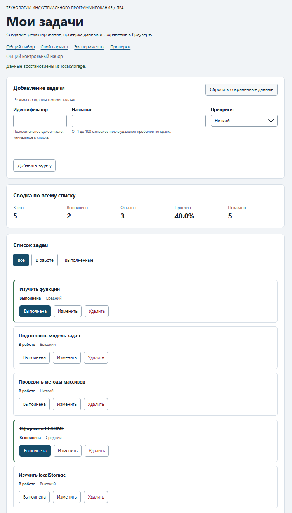

# Практическая работа № 4. Формы, валидация и локальное хранение данных

## Данные работы

| Поле | Значение |
|---|---|
| Имя | Кутлунин Константин Русланович |
| Группа | ЭФБО-15-25 |
| Вариант из ПР2–ПР3 | 1 |
| Node.js | v24.21.0 |
| Браузер | Chrome (DevTools) |
| Операционная система | Windows |

## Запуск

Рабочая папка: `practice-04` внутри личного репозитория.

```bash
npm test
npm start
```

```text
http://127.0.0.1:5504/
http://127.0.0.1:5504/index.html?dataset=variant
http://127.0.0.1:5504/examples/forms-storage.html
http://127.0.0.1:5504/checks.html
```

## Перенос результата ПР3

| Файл | Что перенесено или изменено |
|---|---|
| `data.js` | Перенесен без изменений (общий и индивидуальный наборы) |
| `task-service.js` | Добавлена функция `updateTask` для редактирования |
| `task-selectors.js` | Перенесен без изменений |
| `task-view.js` | Добавлена кнопка `edit` в карточку задачи |

Результат повторных проверок сервиса: 35 пройдено, 0 ошибок.

## Эксперименты с формой и хранилищем

| № | До запуска: прогноз | После запуска: результат | Объяснение |
|---:|---|---|---|
| 1. Пустое обязательное поле | Браузер не даст отправить | Браузер заблокировал отправку | Сработала нативная валидация `required` |
| 2. Название из пробелов | Прикладная проверка отклонит | Отклонено с ошибкой | `trim()` делает строку пустой, `setCustomValidity` показывает ошибку |
| 3. Типы значений `FormData` | Строки | Получены строки | `FormData` всегда возвращает строки |
| 4. Строка в `localStorage` и JSON | Строка JSON | Получена строка | `localStorage` хранит только строки, нужен `JSON.parse` |
| 5. Повреждённый JSON | Ошибка парсинга | Ошибка поймана | `try/catch` вернул исходный набор данных |

## Организация кода

- `task-service.js` — бизнес-логика (без DOM).
- `form-validation.js` — чистая проверка данных формы.
- `task-storage.js` — чтение/запись JSON в localStorage с обработкой ошибок.
- `task-view.js` — создание DOM-карточек.
- `main.js` — связывание формы, хранилища и отрисовки.

Функции хранения получают `storage` аргументом для независимого тестирования. Данные из JSON проверяются через `isValidTaskList`, так как синтаксически верный JSON может содержать неверную структуру.

## Проверка формы

| Сценарий | Ожидаемый результат | Фактический результат | Итог |
|---|---|---|---|
| Добавление корректной задачи | Успех | Добавлено | Пройдено |
| Повторяющийся id | Отказ без изменения списка | Ошибка ID | Пройдено |
| Пустое название | Отказ | Ошибка названия | Пройдено |
| Название из пробелов | Отказ прикладной проверки | Ошибка названия | Пройдено |
| Название длиной 100 | Успех | Добавлено | Пройдено |
| Название длиной 101 | Отказ | Ошибка длины | Пройдено |
| Редактирование title и priority | Меняется одна задача, статус сохраняется | Изменено, статус сохранен | Пройдено |
| Отмена редактирования | Возврат к пустой форме | Форма очищена | Пройдено |

## Общий сценарий

| Шаг | Действие | Видимые id | Всего | Выполнено | Осталось | Прогресс | Состояние storage |
|---:|---|---|---:|---:|---:|---:|---|
| 0 | Исходный запуск после сброса | 1, 4, 7, 10 | 4 | 2 | 2 | 50.0% | Ключа нет |
| 1 | Добавление `id = 20` | 1, 4, 7, 10, 20 | 5 | 2 | 3 | 40.0% | Записано |
| 2 | Отказ для повторного `id = 4` | 1, 4, 7, 10, 20 | 5 | 2 | 3 | 40.0% | Без изменений |
| 3 | Редактирование `id = 4` | 1, 4, 7, 10, 20 | 5 | 2 | 3 | 40.0% | Записано |
| 4 | Переключение `id = 7` | 1, 4, 7, 10, 20 | 5 | 3 | 2 | 60.0% | Записано |
| 5 | Удаление `id = 1` | 4, 7, 10, 20 | 4 | 2 | 2 | 50.0% | Записано |
| 6 | Перезагрузка страницы | 4, 7, 10, 20 | 4 | 2 | 2 | 50.0% | Восстановлено |
| 7 | Сброс данных | 1, 4, 7, 10 | 4 | 2 | 2 | 50.0% | Удалено |

## Проверка восстановления и ошибок

| Случай | Ожидание | Фактический результат | Итог |
|---|---|---|---|
| Записи нет | Используется независимая копия исходного набора | Исходный набор | Пройдено |
| Корректная запись | Данные восстанавливаются после перезагрузки | Восстановлены | Пройдено |
| Повреждённый JSON | Приложение запускается с исходным набором и предупреждением | Запущено с предупреждением | Пройдено |
| Неверная версия или схема | Исходный набор и предупреждение | Предупреждение | Пройдено |
| Сброс | Удаляется только ключ текущего набора | Ключ удален | Пройдено |
| Общий и индивидуальный наборы | Изменения не смешиваются | Разделены | Пройдено |

## Индивидуальный вариант

| Этап | Всего | Выполнено | Осталось | Прогресс | Видимые id |
|---|---:|---:|---:|---:|---|
| Исходный набор | 6 | 0 | 6 | 0.0% | 11, 23, 37, 41, 58, 64 |
| После добавления `75` | 7 | 0 | 7 | 0.0% | 11, 23, 37, 41, 58, 64, 75 |
| После редактирования `23` | 7 | 0 | 7 | 0.0% | 11, 23, 37, 41, 58, 64, 75 |
| После удаления `37` | 6 | 0 | 6 | 0.0% | 11, 23, 41, 58, 64, 75 |
| После перезагрузки | 6 | 0 | 6 | 0.0% | 11, 23, 41, 58, 64, 75 |
| После сброса | 6 | 0 | 6 | 0.0% | 11, 23, 37, 41, 58, 64 |

## Протокол проверок сервиса

```text
Проверок пройдено: 35; не пройдено: 0.
```

## Протокол проверок новых модулей

```text
Проверок пройдено: 27; не пройдено: 0.
```

## Протокол браузерных проверок

```text
Всего: 23. Пройдено: 23. Ошибок: 0.
```

## Собственные проверки

| № | Исходное состояние и действия | Ожидаемый результат | Фактический результат | Итог |
|---:|---|---|---|---|
| 1 | Ввод названия из 101 символа | Отказ | Отказ | Пройдено |
| 2 | Перезагрузка после добавления | Восстановление | Восстановлено | Пройдено |
| 3 | Запись `{broken` в storage | Исходный набор | Исходный набор | Пройдено |

## Отладка и клавиатура

В `handleFormSubmit` установлена точка останова. Проверены значения `draft`, результат `validateTaskDraft`, сервисной операции и строка JSON. Работа Tab, Enter, Space и возврат фокуса проверена.

## Вид приложения



## Дополнительное задание

**Выбранный вариант:** Вариант А — Черновик формы.

**Правила поведения:** Незавершённые поля формы (id, title, priority) сохраняются в localStorage под ключом `tip-js-practice-04:draft:demo` при каждом вводе (событие `input` или `change`). При перезагрузке страницы в режиме создания эти данные восстанавливаются. Черновик не смешивается с сохраненными задачами. При успешном добавлении задачи или сбросе данных черновик удаляется.

**Проверки:**
1. Ввод ID и названия -> перезагрузка (F5) -> поля восстановились.
2. Добавление задачи -> черновик удален, поля пусты.
3. Сброс данных -> черновик удален.

## Вывод

Освоены формы, `FormData`, разделение валидации (HTML и JS), `localStorage`. Различие: HTML проверяет базовую структуру, JS — бизнес-правила (уникальность ID), а проверка после чтения из хранилища защищает от поврежденных данных.